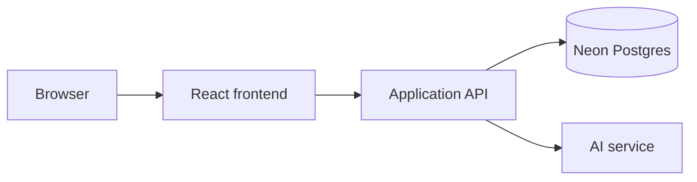

  

<h1 align="center">UrSched</h1>

Intelligent scheduling, simplified.

  
  
  
  

## Live Demo

Try UrSched at **[ursched-two.vercel.app](https://ursched-two.vercel.app)**.

No demo-account credentials are published here. The public landing page includes a sample calendar preview; please use your own account for the interactive app.

## What is UrSched?

UrSched is a scheduling app for people who want to organize their time without turning event entry into busywork. It combines natural-language event creation with month and agenda views, helping individuals see what is coming up and catch scheduling conflicts.

## Key Features

- ✍️ **Natural-language event creation** — describe an event in a sentence instead of filling out every detail by hand.
- 🗓️ **Month and agenda views** — move between a broad calendar overview and a focused daily schedule.
- ⚠️ **Conflict checks** — spot overlapping events before saving.
- 🔔 **Reminders** — keep upcoming plans visible.
- 🌓 **Light and dark themes** — choose a comfortable appearance.
- 🛡️ **Layered security and privacy** — session-focused protections and clear legal information.

## Screenshots / Demo

App screenshots and a demo GIF are not included yet: no dedicated demo account was available while preparing this showcase. No real account data has been captured. See the [media checklist](assets/MEDIA_CHECKLIST.md) for the exact files and safe capture requirements. The logo above is the only product image currently included.

## How the AI Event Creation Works (user view)

Type a request such as **“Lunch with Ana tomorrow at 12:30.”** UrSched turns the sentence into a calendar event. If the time overlaps an existing event, the conflict is flagged before you save. This describes the user-facing experience; it does not expose prompts or model internals.

## Tech Stack

| Area | Technologies |
| --- | --- |
| Frontend | React, TypeScript, Tailwind CSS, shadcn/ui |
| Backend | Node.js |
| Database | Neon (Postgres) |
| Hosting / Tooling | Vercel |

## Architecture Overview

The diagram shows the product at a high level. It intentionally omits endpoints, database schema, and implementation details.

## Security & Privacy

UrSched describes its approach as defense-in-depth session security. The app is served over HTTPS and provides public policy pages. This showcase contains no application source code, account credentials, or user data.

- [Terms](https://ursched-two.vercel.app/terms)
- [Privacy](https://ursched-two.vercel.app/privacy)
- [Cookie policy](https://ursched-two.vercel.app/cookies)

## Roadmap

These are planned directions, not delivery commitments. See [docs/ROADMAP.md](docs/ROADMAP.md) for context.

- **Now:** Continue refining calendar readability, accessibility, and event feedback.
- **Next:** Make onboarding and reminder setup clearer.
- **Later:** Explore optional calendar integrations and richer planning views.

## What I Learned / Engineering Highlights

- A month overview and selected-day agenda give users both a broad and focused view of their schedule.
- Natural-language event entry makes event creation conversational, while the interface still surfaces schedule conflicts before saving.
- Showing event status in the calendar helps distinguish upcoming, ongoing, and past items at a glance.
- Light and dark themes need to work across the product’s public-facing experience.
- Scheduling features are most useful when paired with reminders and clear privacy and consent information.

## About the Developer

Built by **Charlie Melorin**, an independent developer focused on creating useful, approachable web products.

- [Portfolio](https://charliemelorin.vercel.app)
- [LinkedIn](https://www.linkedin.com/in/charliemelorin)
- [Email](mailto:charliemelorin00@gmail.com)

Feedback and ideas are welcome — [open a GitHub issue](https://github.com/xhaiii15/ursched-showcase/issues/new/choose).

## License / Notice

This repository contains documentation and media only. Its contents are **All Rights Reserved**; see [LICENSE](LICENSE). The UrSched application source code is private and proprietary. No license to that source code is granted by this repository.
