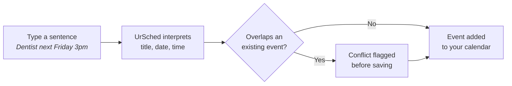

# UrSched

### Intelligent scheduling, simplified.

Describe your plans in plain language. See them on a clean calendar. Never miss a thing.

 

 

[**Overview**](#-overview) ·
[**Features**](#-features) ·
[**Screenshots**](#-screenshots) ·
[**Tech Stack**](#-tech-stack) ·
[**Security**](#-security--privacy) ·
[**Roadmap**](#-roadmap) ·
[**Contact**](#-about-the-developer)

 

 

> [!NOTE]
> **UrSched is currently in active development.** Expect bugs and rough edges, and expect frequent updates as new features and fixes ship. If you run into something broken, please [open an issue](https://github.com/xhaiii15/ursched-showcase/issues/new/choose). Feedback is genuinely appreciated.

 

## 📖 Overview

**UrSched** is a scheduling web app built to remove the busywork from planning your time. Instead of filling out forms, you type what you have planned, such as _"Lunch with Ana tomorrow at 12:30"_, and UrSched turns it into a calendar event. Month and agenda views keep your schedule readable, and conflicts are flagged before you save.

<table>
  <tr>
    <td><b>Product</b></td>
    <td>Responsive scheduling web application</td>
  </tr>
  <tr>
    <td><b>Status</b></td>
    <td>Live, in active development</td>
  </tr>
  <tr>
    <td><b>Try it</b></td>
    <td><a href="https://ursched-two.vercel.app">ursched-two.vercel.app</a></td>
  </tr>
  <tr>
    <td><b>Source code</b></td>
    <td>Private. This repository holds documentation and media only.</td>
  </tr>
</table>

 

## ✨ Features

<table>
  <tr>
    <td width="50%" valign="top">
      <h4>✍️ Plain-language events</h4>
      Type a sentence instead of filling out a form. UrSched handles the title, date, and time.
    </td>
    <td width="50%" valign="top">
      <h4>🗓️ Month and agenda views</h4>
      A broad monthly overview, or a focused list grouped by date with the newest first.
    </td>
  </tr>
  <tr>
    <td width="50%" valign="top">
      <h4>⚠️ Conflict checks</h4>
      Overlapping events are flagged before you save, so double-booking is hard to do by accident.
    </td>
    <td width="50%" valign="top">
      <h4>🎨 Status at a glance</h4>
      Upcoming, ongoing, and past events are color-coded so you can scan your day in seconds.
    </td>
  </tr>
  <tr>
    <td width="50%" valign="top">
      <h4>✨ AI-created markers</h4>
      Events made from plain language carry a clear label, so you always know where they came from.
    </td>
    <td width="50%" valign="top">
      <h4>🔔 Reminders</h4>
      Keep upcoming plans visible so nothing slips past you.
    </td>
  </tr>
  <tr>
    <td width="50%" valign="top">
      <h4>🌓 Light and dark themes</h4>
      A consistent color system that looks right in both modes.
    </td>
    <td width="50%" valign="top">
      <h4>📱 Fully responsive</h4>
      Designed to work comfortably on phones, tablets, and desktops.
    </td>
  </tr>
</table>

 

### How plain-language creation works

This shows the user-facing experience only. Prompts and model internals are not published.

 

## 📸 Screenshots

> All screenshots use sample data only.

<table>
  <tr>
    <td align="center" width="50%">
       
      <b>Agenda view</b> Events grouped by date with status colors
    </td>
    <td align="center" width="50%">
       
      <b>Plain-language creation</b> Type a sentence, get an event
    </td>
  </tr>
</table>

   
  <b>Mobile</b> Responsive down to the smallest screens

 

## 🛠️ Tech Stack

| Layer        | Technologies                               |
| :----------- | :----------------------------------------- |
| **Frontend** | React, TypeScript, Tailwind CSS, shadcn/ui |
| **Backend**  | Node.js                                    |
| **Database** | Neon (serverless Postgres)                 |
| **Hosting**  | Vercel                                     |

### Architecture at a glance

A high-level view only. Endpoints, schema, and implementation details are intentionally omitted. For a plain-language walkthrough, see [docs/ARCHITECTURE.md](docs/ARCHITECTURE.md).

 

## 🔒 Security & Privacy

UrSched takes a layered, defense-in-depth approach to session security and is served over HTTPS. Privacy is part of the product: the policies below are public, and sign-up asks for explicit agreement to them.

[Terms of Service](https://ursched-two.vercel.app/terms) · [Privacy Policy](https://ursched-two.vercel.app/privacy) · [Cookie Policy](https://ursched-two.vercel.app/cookies)

Found a vulnerability in the live app? Please follow the steps in [SECURITY.md](SECURITY.md).

 

## 🗺️ Roadmap

UrSched is evolving quickly. These are planned directions, not delivery commitments. More detail lives in [docs/ROADMAP.md](docs/ROADMAP.md).

- [x] Natural-language event creation
- [x] Month and agenda views
- [x] Conflict checks and event status colors
- [x] Light and dark themes
- [ ] Clearer onboarding and reminder setup
- [ ] Calendar readability and accessibility refinements
- [ ] Optional calendar integrations
- [ ] Richer planning views

 

## 👨‍💻 About the Developer

Built by **Charlie Melorin**, an independent developer focused on creating useful, approachable web products.

Have feedback or an idea? [Open an issue](https://github.com/xhaiii15/ursched-showcase/issues/new/choose). If you like what you see, a ⭐ on this repo is always appreciated.

 

## 📄 License

This repository contains documentation and media only, and its contents are **All Rights Reserved** ([LICENSE](LICENSE)). The UrSched application source code is private and proprietary, and no license to it is granted by this repository.

 

  Built with care in the Philippines 🇵🇭

