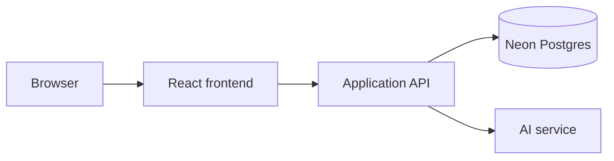

  

<h1 align="center">UrSched</h1>

  <strong>Intelligent scheduling, simplified.</strong> 
  Describe an event in plain language, see it on a clean calendar, and never miss it.

  
  
  
  
  
  
  

  <a href="https://ursched-two.vercel.app"><strong>Live Demo</strong></a> ·
  <a href="#features">Features</a> ·
  <a href="#screenshots">Screenshots</a> ·
  <a href="#tech-stack">Tech Stack</a> ·
  <a href="docs/ROADMAP.md">Roadmap</a> ·
  <a href="https://github.com/xhaiii15/ursched-showcase/issues/new/choose">Feedback</a>

  

---

## Overview

UrSched is a scheduling web app for people who want to organize their time without turning event entry into busywork. Type what you have planned, such as _"Lunch with Ana tomorrow at 12:30"_, and UrSched turns it into a calendar event. Month and agenda views show what is coming up, and conflict checks catch overlaps before they become problems.

|                 |                                                                             |
| --------------- | --------------------------------------------------------------------------- |
| **Type**        | Web application (responsive, mobile-friendly)                               |
| **Status**      | Live and actively developed                                                 |
| **Built by**    | [Charlie Melorin](https://charliemelorin.vercel.app), independent developer |
| **Source code** | Private. This repository contains documentation and media only              |
| **Try it**      | [ursched-two.vercel.app](https://ursched-two.vercel.app)                    |

## Features

|     | Feature                      | What it does                                                                             |
| --- | ---------------------------- | ---------------------------------------------------------------------------------------- |
| ✍️  | **Natural-language events**  | Describe an event in a sentence instead of filling out every field by hand.              |
| 🗓️  | **Month and agenda views**   | Switch between a broad calendar overview and a focused, date-grouped schedule.           |
| ⚠️  | **Conflict checks**          | Overlapping events are flagged before you save.                                          |
| 🎨  | **Status at a glance**       | Upcoming, ongoing, and past events are color-coded so you can scan your day quickly.     |
| ✨  | **AI-created event markers** | Events created from plain language carry a clear "AI" badge.                             |
| 🔔  | **Reminders**                | Keep upcoming plans visible.                                                             |
| 🌓  | **Light and dark themes**    | A consistent color system that works in both.                                            |
| 🛡️  | **Privacy-first onboarding** | Terms, Privacy, and Cookie policies are public, and sign-up asks for explicit agreement. |

## Screenshots

> All screenshots use sample data created for this showcase. No real user data is shown.

<table>
  <tr>
    <td align="center" width="50%">
       
      <b>Agenda view</b> Events grouped by date, newest first, with status colors.
    </td>
    <td align="center" width="50%">
       
      <b>Plain-language event creation</b> Type a sentence and get a ready-to-save event.
    </td>
  </tr>
  <tr>
    <td align="center" width="50%">
       
      <b>Landing page (light)</b>
    </td>
    <td align="center" width="50%">
       
      <b>Landing page (dark)</b>
    </td>
  </tr>
</table>

   
  <b>Responsive on mobile</b>

## How Natural-Language Event Creation Works

1. **You type** a request such as _"Dentist next Friday at 3pm"_.
2. **UrSched interprets** the sentence and turns it into a structured event with a title, date, and time.
3. **You review** the result. If it overlaps an existing event, the conflict is flagged before you save.
4. **The event appears** on your calendar, marked as AI-created so you always know where it came from.

This describes the user-facing experience only. Prompts and model internals are not published.

## Tech Stack

| Area     | Technologies                               |
| -------- | ------------------------------------------ |
| Frontend | React, TypeScript, Tailwind CSS, shadcn/ui |
| Backend  | Node.js                                    |
| Database | Neon (Postgres)                            |
| Hosting  | Vercel                                     |

## Architecture Overview

A high-level view only. Endpoints, schema, and implementation details are intentionally omitted. See [docs/ARCHITECTURE.md](docs/ARCHITECTURE.md) for a plain-language walkthrough.

## Security and Privacy

UrSched follows a defense-in-depth approach to session security and is served over HTTPS. Privacy matters to the product: the legal pages below are public, and sign-up asks users to agree to them explicitly.

- [Terms of Service](https://ursched-two.vercel.app/terms)
- [Privacy Policy](https://ursched-two.vercel.app/privacy)
- [Cookie Policy](https://ursched-two.vercel.app/cookies)

This showcase repository contains no application source code, credentials, or user data. To report a vulnerability in the live app, see [SECURITY.md](SECURITY.md).

## Engineering Highlights

- **Readable by design:** a month overview for planning and a date-grouped agenda for focus, with a "load more" flow so long schedules stay manageable.
- **Clear visual language:** semantic color tokens for upcoming, ongoing, past, and AI-created events keep the interface consistent across light and dark themes.
- **Trust in AI output:** AI-created events are labeled, and conflicts are surfaced before saving, so automation never hides what changed on your calendar.
- **Privacy built in:** public legal pages and explicit consent at sign-up, written for Philippine data privacy expectations.

## Roadmap

Planned directions, not delivery commitments. Details are in [docs/ROADMAP.md](docs/ROADMAP.md).

- **Now:** refine calendar readability, accessibility, and event feedback.
- **Next:** make onboarding and reminder setup clearer.
- **Later:** explore optional calendar integrations and richer planning views.

## About the Developer

Built by **Charlie Melorin**, an independent developer focused on creating useful, approachable web products.

[Portfolio](https://charliemelorin.vercel.app) · [LinkedIn](https://www.linkedin.com/in/charliemelorin) · [Email](mailto:charliemelorin00@gmail.com)

Feedback and ideas are welcome. [Open a GitHub issue](https://github.com/xhaiii15/ursched-showcase/issues/new/choose).

## License and Notice

This repository contains documentation and media only, and its contents are **All Rights Reserved**. See [LICENSE](LICENSE). The UrSched application source code is private and proprietary, and no license to it is granted by this repository.
