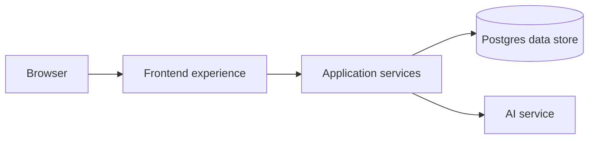

# Architecture Overview

UrSched is presented here as four high-level layers. This is a conceptual overview, not an implementation specification.

- **UI:** A React-based frontend presents the calendar, event creation flow, and user preferences.
- **API:** Application services handle requests from the frontend and coordinate product behavior.
- **Data:** Postgres stores application data.
- **AI service:** Supports natural-language event interactions.

The diagram intentionally excludes routes, schemas, prompts, model providers, and security implementation details.
